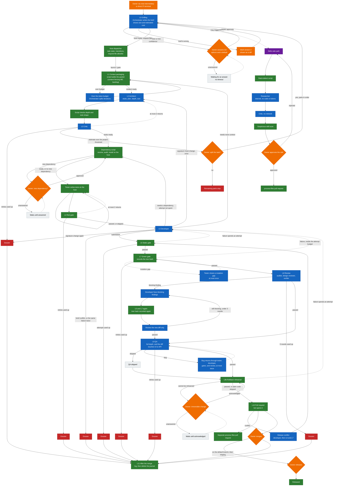

# Architecture

This page is the end-to-end picture of rudax-keel. Terms used here are also collected in the [glossary](glossary.md).

**Status of this page.** The chain below is the v1 design. The repository today contains the GitHub rules, the CI checks, and a container harness that can run a shell command as a named role and reject a bad export. It does not run Pi Agent, and it does not run links L0 through L11. [Implementation status](status.md) says which pieces exist.

A **link** is one step of a task. A **task** is one piece of work from the owner’s message to a merged pull request, or to a stop. A **gate** is a host script that returns pass or fail from evidence, not from an agent’s summary.

## Two planes

The **reasoning plane** proposes. The **control plane** disposes.

Agents sit in the reasoning plane. Each agent has one job: grill a brief, sketch stubs, write tests, write code, review a diff, or exercise a user interface. They run as Pi Agent inside a container. Pi Agent is the runtime the design names for those roles. It is not vendored here.

Host scripts sit in the control plane. They mount files, install dependencies, run tests, measure the diff, open the pull request, and write the log. The planned **dispatcher** is the host script that owns task state and the L0–L11 transition table. An agent cannot skip a script by saying the step passed. When a script and an agent disagree, the script wins.

The same split is already visible in the harness that exists today. `setup/keel.sh role` runs a command in a container. `setup/keel.sh gate` runs on the host, with no token, and accepts or rejects the exported bundle. The role does not get to declare the gate passed. See [Getting started](harness-getting-started.md).

## What the owner sees

The owner does not have to read the code to merge. The owner reads an **envelope**: a script-built summary attached to the pull request. The envelope carries the brief, the gate results, warnings, the rollback evidence, and the cost so far.

The envelope is bound to a **tree hash**. A tree hash is Git’s id for the exact file contents of a commit, ignoring the commit message. The green gate records the tree hash of the files it passed. Later CI blocks the pull request when the files on the branch are not that tree. A commit that appears after the gates, even with the same message, does not keep the old pass.

If the brief is missing its required sections, the script does not open the envelope. Those sections are described in [Human decisions](decisions.md).

## How chat reaches the chain

Usage is natural-language chat. Two front ends share one orchestrator input:

1. An **external chat intermediary** (typical): a chat agent that bridges the owner and the orchestrator in both directions. Primary job: high-quality transfer of meaning. Recommended paste-block: [Intermediary agent instructions](intermediary-agent-instructions.md). Newcomer page: [Working through a chat agent](working-through-chat.md).
2. A **direct Pi Agent terminal** session wired to the same input.

There is no extra confirmation layer on top of D2. The owner merges on GitHub; the intermediary cannot merge or change GitHub rules.

### Orchestrator and host dispatcher

The **orchestrator** is the main Pi Agent role. It writes the brief, split proposals, messages to the owner, **request files**, and the D1 confidence-notes log. It does not write product code or tests. It may read everything except secrets and paths in `.keel/deny.local` (including the D1 log). The **dispatcher** is a host script. It owns task state, a fixed transition table for L0 through L11, gate runs, allowlist checks on request files, and launches of roles via `setup/keel.sh role`. Agents do not talk to each other; they go through the dispatcher. Design detail: [Harness design](harness/README.md).

## The chain

A task moves forward only. A dashed return in the diagram is a retry or a pause, and every retry has a limit. When the limit is used up, a **dossier** stops the cycle. A dossier is a failure record written by a script. Agents do not write the abort note.

The owner’s pauses do not time out. An unanswered question waits until the owner answers it.

Colour in the diagram:

- Blue — an agent (Pi Agent, in a rootless container, in the design)
- Green — a host script
- Orange — a decision the owner makes
- Red — a dossier, the cycle stops
- Purple — the skills side path, which is not one of the numbered links
- Grey — a wait or a skip

Dashed arrows are returns or pauses.

This picture is the v1 design. The repository does not run this chain yet.

## What each link is for

The paragraphs below are the short form. Inputs, outputs, blocks, and retry limits are in the [pipeline](pipeline.md).

**Skills** are not a numbered link. A skill is a file of instructions for one role, kept in the project under `.agents/skills/`. The side path runs when a project starts, when the stack changes, when the same pitfall shows up twice, or when the owner asks. Nothing lands in the repo until the owner approves it. A suspicious skill (install commands, network access, secrets, or a way around a gate) needs its own explicit yes, with the offending lines highlighted.

**L0 Grilling.** The orchestrator turns the owner’s message into a brief: what the task is, a D0 paragraph, a D1 confidence level (not an owner decision), any D2 questions, and a line that says what is out of scope. It also shows size and estimated cost. The owner may raise how deep the rest of the pipeline goes. The orchestrator drops request files; the dispatcher advances the task.

**L1 Context packaging.** A script builds the packet of files and notes the next agents will see. Matching and critical notes are included in full. Everything else is an index line. Content fencing (M5) — wrapping packaged text as data so repository sentences are not treated as instructions — is specified and **deferred to the backlog**. Until fences land, packaging still selects what is mounted; agents must treat packaged text as data by role instruction.

**L2 Stubs and plan.** The architect proposes signatures, a plan, a depth, a dependency list with names and purposes, and a size estimate. A critic challenges the signatures and the plan. A script checks that the depth matches the diff and that the stubs parse. If the estimate is over the project’s split threshold, the owner decides whether to split before any further work.

**Dependencies.** When the architect named new dependencies, a script resolves versions, checks advisories, and installs on the host. A new dependency waits for the owner. The developer’s container does not install packages and does not have a general network.

**L3 Tests.** The tester writes unit and integration tests, plus one or two tests per brief rule. A **** is a test stored on the host that the developer’s container never receives. The tester works on the commit from before the implementation, so the new code is not mounted there.

**L4 Red gate.** A script runs the tests against the stubs (or against the current code, in light depth). A honest red is a failed assertion, or a not-implemented result. An import error or a build error is sent back to the tester. It does not count as a passed red gate.

**L5 Code.** The developer implements the stubs so the tests pass. The developer does not see bodies. Four special exits leave this link early: more context is needed, a signature has to change, a dependency is missing, or the brief conflicts with itself. A missing dependency does not spend one of the three submissions.

**L6 Static gate.** A script blocks on lint, types, signatures that drifted from the stubs, forbidden paths, secrets, and a lockfile that does not match what was approved. It warns on a middle band of complexity and on duplicates. It formats the code itself.

**L7 Green gate.** A script runs new tests, old tests, and the host tests, then mutation testing on the changed files. **Mutation testing** changes a small piece of logic and checks that some test fails. An unexplained survivor on changed logic blocks. The script then records the tree hash.

**L8 Review.** An auditor and, in full depth, a design reviewer read the diff in parallel. A verifier on another model drops findings that have no rule id, no behavioural effect, or that repeat a finding already rejected. Reviewers do not flag formatting, style, or naming. Blocking findings go back to the developer, and the static and green gates run again.

**L9 QA.** Only when the depth is full and the diff touches a user interface or an API. The QA agent drives the local app with Playwright and keeps the browser sandbox on. Otherwise the link is skipped.

**L9b Rollback rehearsal.** A script classifies the diff. Plain code skips the rehearsal. A feature flag, a migration, or an API change is rehearsed. A change that cannot be undone waits for the owner.

**L10 Pull request.** A script pushes the branch and the bot opens the pull request. tests are copied into the normal test suite in a separate commit, by the script. CI runs the script gates again and blocks when the tree hash does not match. The owner merges.

**L11 After the merge.** A script writes the task log, keeps the discoveries the filter accepted, offers a retrospective every few tasks without running one, and deletes the task journal.

## Depth

**Depth** is how much of the chain runs. The script picks it. The architect may propose a depth. The script overrides the proposal when the diff disagrees.

| Depth | When the script chooses it | What runs |
|---|---|---|
| Full | The change adds a dependency, an API, a user interface, or stored data | The whole chain, including the design reviewer and QA when the diff touches a UI or an API |
| Light | None of those are new | Tests, gates, and the auditor. No design reviewer. No QA |
| Trivial | Script rules only: no D2 question, size under the configured line limit, no new public API, no UI or API work | The red gate is skipped |

A task that raised a D2 question is never trivial. If the claimed depth and the diff disagree, the script forces full depth. The owner sees the size and the estimated cost at L0 and again at L2, and may raise light work to full.

The line-count cutoff inside the trivial rule is not set yet. It will be a configured number after the first measured tasks. Until that number exists, the design does not treat any size as trivial by default.

## Split

If the architect’s size estimate exceeds the project’s split threshold, the orchestrator proposes a split immediately, before dependencies and before tests. The owner says yes or no. Accepted parts run one after another, each through the chain from grilling. A no stops the parts that have not started.

The starting threshold is a band of about 200 to 400 lines, counting human-written code and excluding generated files and lockfiles. That band is a configurable default. It has not been checked against this project’s tasks, and it is not presented here as a measured recommendation. Each project can set its own number. See [Status](status.md#settings-still-open).

## Related

[Pipeline](pipeline.md) · [Roles and visibility](roles.md) · [Human decisions](decisions.md) · [Working through a chat agent](working-through-chat.md) · [Implementation status](status.md)
