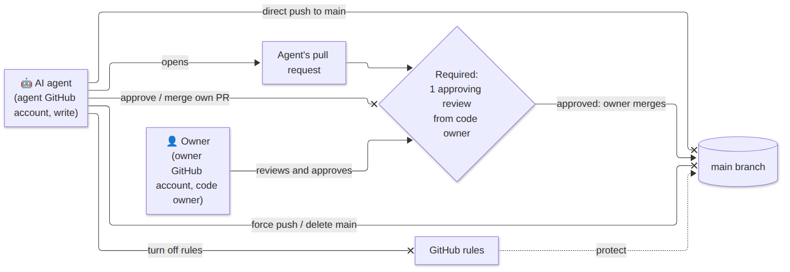
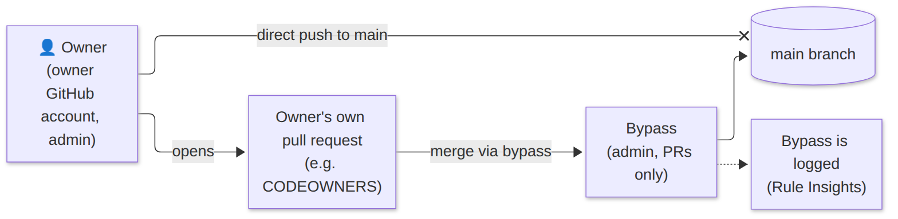

# GitHub setup

This is the foundation. Everything else in the template relies on it.

## Two accounts

| Name | Who | Role in the repo |
|---|---|---|
| **Owner GitHub account** | You, the human | Admin, code owner |
| **Agent GitHub account** | The account AI agents act through | Write (not admin) |

Each account has one name and one job, so it's always clear who did what.

## Process 1: the agent's pull request (the everyday flow)



The agent can only do one thing: **open a pull request**. Then:

1. GitHub requires **one approving review from a code owner** (you).
2. After you approve, **you** merge it into `main`.

Everything else is blocked:

| Blocked action | Why |
|---|---|
| Direct push to `main` | Every change must pass through a PR you can see and review. |
| Approve or merge its own PR | An agent checking its own work isn't a check. Only a human decides. |
| Force push or delete `main` | History must stay intact, so nothing can be hidden or lost. |
| Turn off the rules | The agent has **write**, not **admin**. Only admins can change rules, so the agent can't free itself. |

**Why it works:** the rules are enforced by GitHub itself, not by the agent's good behaviour. Even a buggy or misled agent can't put code into `main` without you.

## Process 2: the owner's own pull request



Sometimes you change things yourself, for example the `CODEOWNERS` file. GitHub doesn't let anyone approve their own PR, so the review rule would block you forever. That's why there's a **bypass**:

1. You open a PR, as usual.
2. You merge it through the bypass. The bypass is for the **admin role, pull requests only**.
3. Every bypass is logged in Rule Insights (Settings → Rules → Insights), so you can see when it was used.

### Why you can't push directly to `main`, even as owner

The bypass is set to **"pull requests only"**, not "always". So you still have to go through a PR. That gives you:

- **A record of every change.** Each change to `main` has a PR showing what changed and why, even your own.
- **One way in.** Everything, from the agent or from you, enters `main` the same way. That's simple to understand and to audit.

Layer 2 adds the status checks. Until both workflow files are on the default branch and every required check-run name has been reported by GitHub Actions, `require-checks` is NOT YET. See [Layer 2](#layer-2).

## What the script configures

Do this as the **owner GitHub account** (admin on the repo). Never use the agent GitHub account's token. Commands: [setup/README.md](../setup/README.md). Reasons: [why.md](why.md).

There is no config file. Apply asks GitHub who is logged in (`gh api user`). That login is the owner GitHub account. It also reads whether the repository is public or private, and the plan.

From the repository root:

```bash
bash setup/apply-github-rules.sh OWNER/REPO AGENT_LOGIN
bash setup/verify-github-rules.sh OWNER/REPO AGENT_LOGIN
```

Apply is idempotent. Run it again after each layer is merged. A setting that already matches is left untouched.

| Step | What it sets |
|---|---|
| `CODEOWNERS` | First, before `protect-main`. Write `* @<login>` only when the file is missing or is still the template line. If it already matches the logged-in owner, no commit is made. Any other content is FAIL unless you pass `--rewrite-codeowners`, and that flag does nothing once `protect-main` exists. If this step FAILs, `protect-main` is still created. The fix is a pull request the owner merges. See [why](why.md#codeowners). |
| `protect-main` | Default branch: no deletion, no force push, pull request required, 1 approval, code-owner review, dismiss stale reviews. Admin bypass for pull requests only. |
| `protect-tags` | All tags: block creation, update, and deletion. Only an admin may bypass, because only the owner creates releases. |
| `require-checks` | Requires the check-run names `keel-gate` and `keel-process-files-separate`, strict (branch up to date), no bypass, each limited to GitHub Actions (`integration_id` 15368). NOT YET until both workflow files are on the default branch and each exact name has been reported by app 15368. `keel-process-files-separate` reports on pull requests, not on a push to the default branch. |
| Agent access | Invite `AGENT_LOGIN` with write. If that account already has admin, the step is FAIL and the role is left unchanged. |
| Actions token | Default `GITHUB_TOKEN` is read-only and cannot approve pull requests. |
| Fork approval | On a public repository, require approval for fork pull request workflows from all outside collaborators. On a private repository the step is OK: `not applicable (private repo)`. |
| Allowed actions | GitHub-owned actions, plus the exact `uses:` values in workflows on the default branch. |

The agent GitHub account must accept the collaborator invitation before verify's agent-role step can pass.

<a id="how-rulesets-stack"></a>

## How rulesets stack

The script keeps more than one ruleset. GitHub applies every active ruleset that matches a ref. A bypass applies only inside its own ruleset.

- The admin bypass on `protect-main` lets you merge a pull request without a second review. It does not let you force-push, and it does not apply to tags.
- `protect-tags` has its own admin bypass. The pull-request bypass mode is not valid for tags, so this one is "always", and only the admin role is on the list. Only the owner creates a release tag. The agent GitHub account has write, not admin, so it cannot create, move, or delete a tag, and it cannot fake a release.
- `require-checks` has an empty bypass list. After it is active, an admin cannot skip `keel-gate` or `keel-process-files-separate`, and the `protect-main` bypass does not skip them either. The branch must be up to date. A status posted with a user token does not count, because the check is limited to GitHub Actions. A deliberately malicious agent can still post a check run of that name from a workflow with `checks: write`. Owner review is the control for that. See [why](why.md#require-checks).

## Manual setup

Do these as the owner GitHub account, in this order. The script does the same thing.

1. **Write CODEOWNERS with your own account**, before any ruleset. Add `.github/CODEOWNERS` containing `* @YOUR_LOGIN`. [Why](why.md#codeowners).
2. Create `protect-main`, then `protect-tags`. Create `require-checks` after `keel-gate` and `keel-process-files-separate` have each been reported by GitHub Actions app 15368. `keel-gate` can be a push to the default branch. `keel-process-files-separate` runs on a pull request.
3. Invite the agent GitHub account with write, not admin.

JSON for the three rulesets lives in [setup/rulesets](../setup/rulesets).

## Layer 2

A status check is a pass or fail name on a commit. The required names are `keel-gate` and `keel-process-files-separate`. `keel-gate` fails if any job in [checks.yml](../.github/workflows/checks.yml) failed, was cancelled, or was skipped. `checks` runs on `opened`, `synchronize`, `reopened`, and `edited`, so a base change runs the gate again. Add this repository's tests only in `project_checks()` in [`scripts/check.sh`](../scripts/check.sh). The workflow `project` job only calls that function. `bash scripts/check.sh` is the local run. The template's own check tests live in `scripts/tests/`. Product tests live in `tests/`.

`require-checks` requires those two check-run names. The pull request branch must be up to date. Both are limited to GitHub Actions (`integration_id` 15368), so a status posted with a user token does not count. That does not stop a workflow with `checks: write` from posting the same name. Owner review is the control against a deliberately malicious agent. Apply waits until both workflow files are on the default branch and each exact name has been reported by app 15368. Scope does not run on a push to the default branch.

`scope` is triggered with `pull_request_target` (`opened`, `synchronize`, `reopened`, `edited`) so the workflow definition is the one on the pull request's base branch, and changing the base runs it again. The job does not check out the pull request and the token is read-only. That is the safe use of that trigger. The check fails if the base is not the default branch. A pull request that touches process files must not also touch other files. A process-only pull request can weaken `checks.yml`; owner review of those pull requests is the control, by design. To turn the check off, disable `require-checks` or remove the `keel-process-files-separate` context first, then delete the workflow. Do not delete the workflow alone. [Why](why.md#scope).
