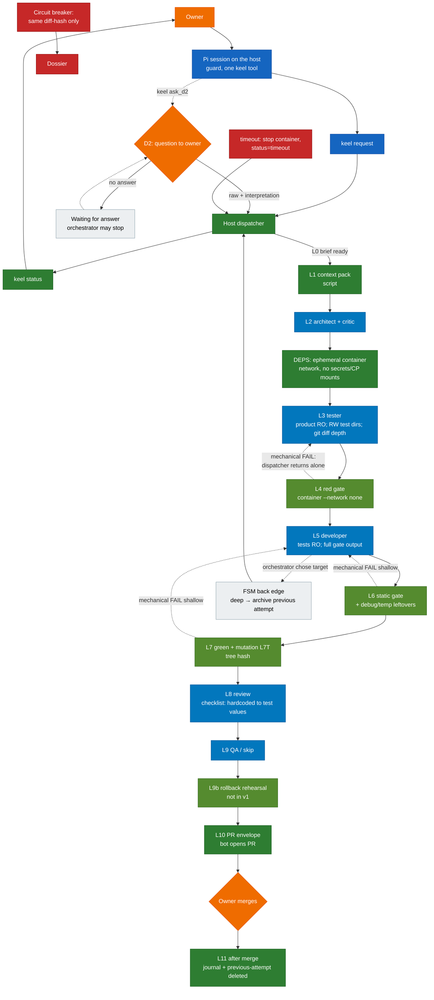

# Orchestrator, dispatcher, and role containers

Design for the Step 7 layer. Numbers not yet measured are marked **starting value, measure**. Among AI runtimes, the pipeline names **Pi** only.

**Status.** Planned. The repository today has role isolation and a host-gate prototype. Nothing in this layer is built. The orchestrator is stock Pi on the host, started by the user in the root of their own clone. Implementation ships as process-files pull requests.

---

## 1. Two planes in plain words

| Plane | Who | Does | Does not |
|---|---|---|---|
| **Reasoning** | Orchestrator (stock Pi on the host, in the owner's clone, one `keel` tool) and roles (in containers) | Understand the task, write the brief, choose *where* to request a transition, ask D2, read what is allowed | Launch containers, write product code, skip gates, message peer agents |
| **Control** | Host dispatcher (a script, not an agent) | Store task state, check transitions, mount, launch roles via `setup/keel.sh role`, run gates, write journals and the status line | “Think” for the model; merge the PR |

Rule: **agents do not talk to each other**. Everything goes through the dispatcher. There is no scribe agent: append-only journals are written only by the dispatcher.

D2 questions and approvals happen in the owner's Pi session on the host. An intermediary chat agent is optional. There is no second “confirm again” layer on top of D2. There is no `/approve` command.

---

## 2. Path of one task: from a chat message to a PR

### Mermaid



### In words, step by step

1. The owner works in a Pi session on the host, in the root of their own clone. An intermediary chat agent is optional and relays into that session. There is no launcher, socket, bridge, or daemon.
2. Intermediary: for D2, passes the **raw answer text** and its **interpretation**; if unclear or they diverge, the orchestrator re-asks; raw text in the audit log. Relay checklist: critical content is not lost; end with what the user must do (or “nothing”). No `/approve`.
3. There is no inbox. A message typed during a turn waits until the turn ends. Priority interrupt and mid-turn cancel are later work. `keel status` prints the status line, with no model and no secrets. It is shown at session start and on the owner's next turn.
4. The orchestrator reads what is allowed (see §4) and calls at most one state-changing `keel` request per turn. The guard counts between Pi's `turn_start` and `turn_end`. A second request is refused as `second_request_same_turn` and audited. The guard computes the idempotency key.
5. The dispatcher re-validates every request (schema, allowlist, FSM, budget, turn count, and replay) regardless of the guard. It checks the allowlist and the YAML FSM, writes WAL `IN_PROGRESS` before the side effect and `COMMITTED` after, writes the status line, launches a role or gate when needed, and journals and audits.
6. The L0…L11 chain is as in `docs/architecture.md` / `docs/pipeline.md`; routing goes through the dispatcher FSM.
7. At task end, task files go through `keel cleanup`, which is not a deploy and not a model verb. The previous-attempt folder is **deleted**. Waiting on the user needs no stop.
8. The owner merges and releases by hand, outside the harness. The intermediary does not merge and does not change GitHub rules.

---

## 3. Who decides what

| Decision | Who |
|---|---|
| Task meaning, brief text, D1 (confidence high/medium/low), D2 wording, choice of **target** back edge; on `TEST_CONTRADICTS_BRIEF` — verify claim vs brief, reformulate finding for L3 (never forward developer prose) | Orchestrator (request) |
| Whether to allow a transition / return; whether to execute a `keel` request; launch role/gate; invalidate artifacts; deep archive / shallow keep; status line; journal; circuit breaker (diff-hash); timeout stop; **auto-return on mechanical FAIL**; refuse a second request in the same turn | Dispatcher |
| D2 answers, split yes/no, new dependency, irreversible ack, skill yes/no, merge, release | Owner / user |
| Relay: raw D2 + interpretation; show status line; **not** a second confirmation layer; **not** `/approve` | Intermediary |
| Own work within the role; L5 signals `NEEDS_CONTEXT` / `NEEDS_DEPENDENCY` / `TEST_CONTRADICTS_BRIEF` / … | Role container (developer) |
| Gate pass/fail from evidence | Gate script in a container with `--network none`, no secrets |

The orchestrator does **not** choose “skip the gate”. On mechanical FAIL the dispatcher **itself** takes the YAML edge with `initiator: dispatcher_only` and returns the task — without a model vote.

---

## 4. Visibility: tests visible, read-only for the developer

| Who | Product tests |
|---|---|
| Every role with a work tree (Step 7 design) | Sees ordinary tests |
| Tester | Product tree **RO** mounts; writes **only** test dirs (FS); host `git diff --name-only` defense in depth (D-T30) |
| Developer | Tests **RO**; full gate output + stacks on FAIL |
| Orchestrator | Reads tests (like everything else except secrets / `deny.local`) |

Today only the developer, the tester, and the orchestrator mount `tests` (`setup/allow/*.paths`).

Honesty substitute: **L7T mutation** + **L8** (English checklist item above; mutation does not catch hardcoding). The L8 item is **not** verified by a line-check of the instruction file — only behaviorally through a backlog known-bad eval set.

### 4.1 Failure schema for routing (closed enum)

The dispatcher returns a structured failure object to the orchestrator through `keel wait` and `keel status` for **routing/audit**. Fields:

| Field | Type | Rule |
|---|---|---|
| `pass` | bool | required |
| `failure_category` | enum from `failure_categories` in `dispatcher-transitions-v1.yaml` | required on fail; **not** a free string |
| `rule_id` | short brief rule id (if any) | optional |
| `gate` | gate id (`L4` / `L7` / …) | optional |

In parallel, on gate FAIL the developer receives the **full** output and stacks.

### 4.2 Developer result signals (L5)

Alongside `NEEDS_CONTEXT`, `NEEDS_DEPENDENCY`, `SIGNATURE_CHANGE_NEEDED`, `BRIEF_CONFLICT` — signal **`TEST_CONTRADICTS_BRIEF`**.

Developer instruction (sense; English wording in the role skill/instruction file): *if a test contradicts the brief, do not fit the code to it; stop and return `TEST_CONTRADICTS_BRIEF`, naming the test and the brief clause.*

The dispatcher accepts the signal as `result_name`. The orchestrator **checks the claim against the brief itself** and **decides** whether to call `return_to` L3 on YAML edge `L5_test_contradicts_brief_to_L3` (`budget_ref: L5_test_contradict_returns`, starting value, measure; deep_reset). Developer arguments are **never** forwarded to the tester; only the orchestrator’s own reformulated finding (test id + brief clause + verdict) goes to L3. Behavioral stubs: D-T25 (routing/budget), D-T31 (developer text absent from L3 input).

The orchestrator may read the repository except secrets, `.keel/deny.local`, and the runtime folder `.keel/workspace/`. It reaches task files, logs, and state only through `keel read`, `keel logs`, and `keel status`. `keel read` checks the task id, refuses symlinks, and returns regular files only, with size caps, control characters and ANSI and bidi characters stripped, a random fence, and an audit record. It never returns tokens or `state/`. `keel logs` is redacted and truncated. In v1, content fencing applies to `keel read` and `keel logs` output only. Fencing of `keel status`, role outputs, task summaries, and pull request comments is later work. The primary control stays the guard and the explicit-yes cards.

Control-plane writes go only through the `keel` tool. The orchestrator has no bash, write, or edit tool.

---

## 5. FSM: machine table, transitions, invalidation

**Sole source of edges** — the machine file:

| Where now (design) | Where in the repo after Step 7 (process-files PR) |
|---|---|
| `docs/harness/dispatcher-transitions-v1.yaml` | `setup/dispatcher/transitions.v1.yaml` |

The dispatcher and its tests **load the same file**. Prose tables below are a human overview; on conflict the YAML wins. Test D-T20 loads the YAML and checks edges directly (forbidden/allowed, `invalidates`, `initiator`, **every `kind:back` has non-null `budget_ref`** — D-T19).

### 5.1 File schema

```text
schema_version: 1
format: keel_dispatcher_transitions
failure_categories: [enum…]      # closed list, no free text
budget_refs: [names…]            # numbers are starting values, measure; do not duplicate here
stages: [start, L0, …, dossier]
edges:
  - id: string
    from: stage | "*"
    to: stage | "*"
    kind: forward | back | terminal | reject | side_effect
    initiator: dispatcher_only | orchestrator | owner | script
    when: { … }
    invalidates: [stage…]
    budget_ref: name | null      # null is forbidden when kind is back (schema and D-T19)
    spends_submission: bool?
    deep_reset: bool?            # archive the previous attempt and reset work/$T
    shallow_keep_worktree: bool? # gate to L5: code stays
    note: string?
```

Invalidation: dependent stages → `stale`. Role re-entry: **prior work + reason** (or archive previous attempt on deep). Gates **always** re-run fully. A current PASS exists only for non-stale. PR/envelope with a stale `gated_tree_sha` — **refuse**.

**Deep vs shallow:**
- Deep back to L2 or L3 (`deep_reset: true`): archive into RO `previous attempt` in the task service directory (outside work tree and git); `work/$T` → clean stage commit; archive deleted at task end; tests D-T26. The developer **keeps read access** to the previous-attempt folder; gates/review still judge the new result.
- Shallow (gate → L5): code in the work tree stays for further edits. L6 also fails on leftover debug/temp artifacts in the diff (D-T33).

Budgets: named refs; **numbers are starting values — measure**. Exhaustion → `budget_exhausted` → dossier.

Depth `light` / `trivial` — profiles of the same FSM (some nodes skipped), not a separate product.

### 5.2 Forward edges overview (human)

See the YAML. Short: `start→L0→…→L1→L2→L2C→DEPS→L3→L4→L5→L6→L7→L8→L9→L9B→L10→WAITING_MERGE→L11`, plus waits for D2 / brief v2 / split / dep / irreversible. Forward edges: see the YAML.

### 5.3 Back edges and cascade overview

| Edge (id in YAML) | Initiator | Invalidates | Note |
|---|---|---|---|
| `L4_fail_to_L3` | `dispatcher_only` | L4+ | mechanical FAIL; deep |
| `L2C_return_L2` | orchestrator | L2C and after | `L2_critic_returns`; deep |
| `L5_to_L1_context` | orchestrator | L1 pack | `L5_context_returns`; does not spend submission |
| `L5_to_L2_signature` | orchestrator | after L2 | `signature_change_once`; deep |
| `L5_to_DEPS` | orchestrator | — | `L5_deps_returns`; does not spend submission |
| `L5_test_contradicts_brief_to_L3` | orchestrator | L3+ | `L5_test_contradict_returns`; deep |
| `L6_fail_to_L5` / `L7_fail_to_L5` / `L9B_fail_to_L5` | `dispatcher_only` | gates+after; tree stale | mechanical FAIL; **shallow** |
| `L7_to_L7T` | `dispatcher_only` | L7 | `L7_mutation_gap`; mutation ≠ hardcode catch |
| `L8_blocking_to_L5` | orchestrator | L6+ | `L8_review_rounds`; shallow; hardcode checklist |
| `L9_bug_path` | orchestrator | QA-dependent | `L9_qa_bug_returns`; deep |
| `L10_refuse_stale_tree` | `dispatcher_only` | — | reject, do not open PR |
| `*_budget_dossier` / `any_circuit_breaker` | `dispatcher_only` | — | stop; CB diff-hash only |

**Forbidden:** jump over stale; accept an old gate PASS after a back-edge; open a PR with a stale bind; a back edge without `budget_ref`.

---

## 6. Tool `keel`: kinds and verbs

Planned. The orchestrator has one `keel` tool and no bash, write, or edit tool. The table below is the request kinds. The verbs follow.

Common fields:

| Field | Meaning |
|---|---|
| `schema_version` | Schema version |
| `task_id` | Task id |
| `kind` | Enum below |
| `idempotency_key` | Computed by the **guard** deterministically: `hash(task, stage, attempt, kind, canonical payload)`. WAL: `IN_PROGRESS` before execute, `COMMITTED` after. Replay of `COMMITTED` → no second execution; audit `idempotent_replay`. Restart with `IN_PROGRESS` → reconcile side effect, then complete or safe retry (D-T18 / D-T32) |
| `payload` | Kind fields |
| `created_at` | Timestamp with zone |

### Kinds (v1 allowlist)

| `kind` | Purpose | Key `payload` fields |
|---|---|---|
| `ask_d2` | Question to the owner | `question`, `options[]`, `default`, `trigger_reason` |
| `brief_upsert` | Brief | D0/D1/D2/oos sections; `version` |
| `record_d1` | Confidence notes | `level` (enum high/medium/low), `notes` |
| `propose_split` | Split | `parts[]`, `estimate_ref`, `reason` |
| `advance` | Move forward | `to_stage`, `result_name` |
| `return_to` | Back edge | `to_stage`, `failure_category` (enum) |
| `run_role` | Launch a role | `role`, `stage`, `inputs_ref` |
| `wait_user` | Wait | `reason` enum: `d2` / `brief_v2` / `dep` / `irreversible` / `skill` |
| `dossier` | Stop | `failure_category` enum, `artifact_refs[]` |
| `record_decision` | ADR / decisions / discovery candidate | `target`, `body_ref` |

### Verbs

The owner runs `keel doctor`. The model does not. Cleanup is not a model verb.

| Verb | Purpose |
|---|---|
| `start` | Start a task. Refuses on drift or when the guard marker is missing |
| `wait` | Return the stage summary |
| `status` | Print the status line, with no model and no secrets |
| `cancel` | Cancel a task |
| `ready` | Refuse on drift or when the guard marker is missing |
| `read` | Read one task file: task id checked, no symlinks, regular files only, size caps, control characters and ANSI and bidi characters stripped, a random fence, an audit record, never tokens or `state/` |
| `logs` | Show redacted, truncated logs |

`inject_summary_ack` is **not** in the v1 enum (backlog). The stage summary is returned by `keel wait` and `keel status`. It is not pushed.

The dispatcher rejects an unknown `kind`, a broken schema, a transition outside the YAML, a budget overrun, a second request in the same turn, and a `COMMITTED`-key replay. Every refusal is an **explicit refusal** + **audit entry**.
The dispatcher re-validates every request (schema, allowlist, FSM, budget, turn count, and replay) regardless of the guard.

**One request per turn:** the guard counts state-changing requests between Pi's `turn_start` and `turn_end`. A second is refused as `second_request_same_turn` and audited. The guard computes the idempotency key. The two-phase write-ahead log stays: `IN_PROGRESS` before the side effect, `COMMITTED` after.

The guard is the project extension `.pi/extensions/keel-guard`. Pi trusts only the exact clone path. No trust entry may cover the harness root. The guard applies that one `keel` tool on every session start, including a resumed session. It compares `.pi/**`, `.agents/**`, `AGENTS.md`, `.keel/config`, and `.keel/deny.local` with the default branch in `.keel/workspace/repo`. On a difference it refreshes that copy once and checks again, then fails closed. `keel start` and `keel ready` refuse on drift or when the guard marker is missing. The marker is per session (a random value, the process id, and the start time) and is deleted at session end. The local model choice file is not part of this check. Pi's `defaultTools: []` setting covers only the case where project settings loaded and the guard then failed.

The guard cannot detect its own absence. Pi started from a subfolder, or with trust declined, is ordinary Pi with bash. Running Pi from the project root is the user's job. There is no warning for a missing guard. Instead the guard shows a short "keel is active" greeting at session start that names the model provider and the data-collection setting. Plain Pi shows nothing, so the absence is visible.

---

## 7. Status line

The status line is the output of `keel status`. It carries no model output and no secrets. It is pull-based: shown at session start and on the owner's next turn. There is no inbox.

Fields: `task_id`, `stage`, `attempt`, `waiting_reason`, `container_alive`, `last_result` (result name or `timeout` / `rejected_request` / `idempotent_replay` / `second_request_same_turn`), `updated_at` (with zone).

Secrets never appear. It is not a second confirmation UX.

---

## 8. Sessions, warm vs cold, parallel tasks

| | Orchestrator | Role |
|---|---|---|
| Lifetime | The owner's Pi session on the host | Ephemeral `--rm` per stage |
| Pi mode | Ordinary interactive Pi. The guard applies one `keel` tool on every session start, including a resumed session | One-shot `--mode json` / print (argv — smoke) |
| Pause | Waiting needs no stop | New container |
| Session file | Private (`0600`) and never exported to HTML | — |

Parallelism: already in `setup/keel.sh` — own `TASK`, `work/$T`, `shadow/$T.git`; objects RO alternates; pointer `.git` RO. Not reopened here.

The orchestrator session is **not** mounted into roles (explicit assert in D-T6 / D-T10).

---

## 9. Gates with product code and DEPS

Any product-code run in gates uses a HARDEN container (`--network none`, no secrets, cap-drop, read-only root + tmpfs, limits) as in `setup/keel.sh`. The dispatcher/doctor **refuse** a script that runs pytest/build on the host OS (D-T17). After `GREEN_PASS` — `gated_tree_sha`; stale bind → refuse PR (D-T15).

**DEPS:** install in an **ephemeral** container **with network**, without host secrets and without control-plane mounts; result (cache/vendor) mounts **RO** into later roles. Default `--ignore-scripts`. Test D-T22.

Green gate: new + old tests + mutation (L7T). L6 static gate also checks leftover debug prints/breakpoints and temp/scratch/backup files in the diff (D-T33; patterns configurable, no invented thresholds).

---

## 10. Circuit breaker and hash stability

Inside existing attempt budgets. Two **consecutive** attempts of the same edge:

1. **Diff-hash** — normalized hash of the role patch (stable file order; ignore harness-rewritten fields per a fixed list in the normalizer).
2. Gate-output hash is **not** a circuit-breaker trigger. The same gate fail with a **different** diff spends the ordinary edge budget, not CB.

Match of the **same** consecutive diff-hash only → `failure_category: circuit_breaker` → dossier.

**Done-when for §10:** CI has a **hash-stability fixture** (D-T21): the same normalized input → the same diff-hash across repeats; a mutant that breaks normalization goes red. D-T12: CB only on diff-hash; different diff with the same gate fail → **not** CB. **Backlog:** normalize comments and formatting before the circuit-breaker hash only after measurements on real tasks. Do not invent how aggressive that normalization is.

---

## 11. Timeouts

Each stage: DEFAULT wall timeout + short container-start timeout. Seconds in config: **starting value, measure**. On fire: stop the container, `status=timeout`, `failure_category: timeout`. Then follow YAML and budgets. Owner D2 wait is not killed by these timeouts.

---

## 12. Crashes and recovery

Truth is on disk. On start: rehydrate store → last clean SHA → orphan cleanup by name/label `task_id` → the owner resumes the Pi session and the guard re-applies its tools; reconcile runs on the next keel call; do not resurrect mid-flight roles. The Docker-label graph is not the source of truth (v1). Idempotency WAL survives crash: `COMMITTED` keys → idempotent replay; `IN_PROGRESS` → reconcile side effect then complete or safe retry — never silent skip, never blind re-run (D-T18 / D-T32).

---

## 13. Context rot and monitoring

Stage summaries to the orchestrator (structured), not full logs. Pi compaction is not the only defense. The session path is absent from role mounts.

Monitoring: transition/reject/timeout/circuit-breaker journal; status line; attempt/stale; alert on circuit breaker and `second_request_same_turn`; a message typed during a turn waits until the turn ends (D-T23). Priority interrupt and mid-turn cancel are later work.

Journals are written by the host/dispatcher. Raw D2 text is in the audit log.

---

## 14. L8 checklist and mutation

In the L8 reviewer checklist (English, in the instruction file) an explicit item:

`Code hardcoded to specific test values instead of implementing the behavior`

Mutation (L7T) does **not** replace this item: mutation does not catch hardcoding. The item is **not** in the automated suite as an instruction-file text check. The suite holds **only behavioral** tests (stub model + host fixtures); there are no line/verbatim checks of instruction files. L8 hardcode quality is checked **only** through a backlog known-bad example in a future reviewer eval set.

---

## 15. Risks (open)

- Hardcoding to visible tests — mitigation: L8 English checklist item + known-bad eval backlog (behavioral); not mutation; not instruction-file line-checks.
- Paraphrase / divergence of raw D2 and interpretation — orchestrator re-asks.
- Deep archive leak into git/PR — D-T26; path outside the work tree.
- Budget numbers — starting values, measure. The per-task total budget stays warn-only until it is measured.
- Mid-turn cancel waits until the turn ends.
- Stripping comments before the circuit-breaker hash waits until false positives and false negatives are measured.
- The developer may read the previous-attempt archive. Gates and review still check the new result.

---

## 16. Dispatcher tests (stub-model), wiring into `run-tests.sh` / keel-gate

Style: stub model + host fixtures; mutants like `mutate.py` (remove a protection → expected D-T* go red). Step 7 process-files pull requests: add calls in `run-tests.sh` / keel-gate (mutate wiring is part of Step 7 done-when).

| Id | Checks |
|---|---|
| D-T1 | Forbidden transition → **explicit refusal** + audit; stage unchanged |
| D-T2 | Allowed YAML transition executes; journal append |
| D-T3 | Invalidation: stale; old PASS not accepted; gate re-run |
| D-T4 | Broken request → refusal + audit; not executed |
| D-T5 | No write/bash on orchestrator → explicit refuse + audit; mutant “restore write” goes red |
| D-T6 | Session isolation: orchestrator session path **absent** from role mounts; secrets/`deny.local` not visible to orchestrator |
| D-T7 | Tester write-scope (host): path outside test dirs → refuse + `test_write_scope_violate`; tests RO for developer (write → EROFS). Mount-level product read-only for L3: see D-T30 |
| D-T8 | Timeout: DEFAULT fixture (**starting value, measure**) → stop, `status=timeout` |
| D-T9 | Crash recovery: rehydrate + last clean SHA; orphan removed |
| D-T10 | Parallel tasks: two TASKs isolated; session A not in mount B |
| D-T11 | Status-line: required fields; no secrets |
| D-T12 | Circuit breaker: two identical **diff-hash** in a row → dossier; same gate fail with **different** diff → **not** CB, spends budget |
| D-T13 | no longer used: the host design has no rpc input |
| D-T14 | Mechanical FAIL auto-return without an orchestrator `keel` request |
| D-T15 | Stale `gated_tree_sha` → refuse PR; audit |
| D-T16 | Orchestrator rm at end; after D2-wait — stop, not rm |
| D-T17 | Host product-code gate refuse |
| D-T18 | Idempotency: replay of `COMMITTED` key → no second execution; audit `idempotent_replay`; crash after commit before session flush still safe. Mid-effect crash / `IN_PROGRESS` reconcile: D-T32 |
| D-T19 | Budget: every `kind:back` has non-null `budget_ref` (schema + loader); exhaustion → dossier; mutant “null budget on back” goes red |
| D-T20 | YAML FSM directly: forbidden/allowed edges; `invalidates`; `initiator`; every `kind:back` has non-null `budget_ref` |
| D-T21 | Hash-stability: fixed input → stable **diff-hash**; normalizer mutant goes red |
| D-T22 | DEPS ephemeral: network present; no host secrets / control-plane mounts; cache/vendor RO afterward; `--ignore-scripts` by default |
| D-T23 | A second state-changing `keel` request in the same turn → `second_request_same_turn`; a message typed during the turn waits until the turn ends |
| D-T24 | Deterministic idempotency key: same `(task, stage, attempt, kind, canonical payload)` → one key; different payload → different |
| D-T25 | Behavioral stub: stub-developer returns `TEST_CONTRADICTS_BRIEF` (test name + brief clause); orchestrator chooses `return_to` L3 → dispatcher takes `L5_test_contradicts_brief_to_L3`, spends `L5_test_contradict_returns`, deep archive; repeat to exhaustion → dossier |
| D-T26 | Deep archive previous-attempt: outside work tree/git; not in commit/PR; deleted after task end; shallow L5 keep worktree |
| D-T27 | Intermediary D2: raw text + interpretation arrive; on divergence — re-ask; raw in audit; no `/approve` path |
| D-T28 | Developer on FAIL receives full gate output / stacks (not sanitized “rule text only”) |

**No D-T29.** The L8 hardcode item lives in the English checklist instruction; its presence is **not** tested by a line-check of the instruction file. Suite = behavioral stubs only. Item quality — backlog known-bad eval set.

| D-T30 | L3 mounts: product tree read-only; writes only in test dirs. Stub: tester tries to write a product file → write fails (EROFS / equivalent). Host `git diff --name-only` still refuses out-of-scope paths (defense in depth with D-T7). Mutant: RW product mount → D-T30 red |
| D-T31 | `TEST_CONTRADICTS_BRIEF`: stub-developer returns signal with distinctive developer prose; orchestrator reformulates; L3 input must **not** contain the developer text (only orchestrator finding). Mutant: forward raw developer args → D-T31 red |
| D-T32 | Two-phase WAL: write `IN_PROGRESS`, kill dispatcher before `COMMITTED`, restart; side effect happens **exactly once** (reconcile then complete or safe retry — never silent skip, never blind double-run). Mutant: skip reconcile / blind re-run → D-T32 red |
| D-T33 | L6 leftover debug/temp: diff with a leftover breakpoint or temp/scratch/backup file → L6 FAIL (`static_debug_leftover` or configurable pattern hit). Patterns configurable; no invented thresholds. Mutant: disable leftover check → D-T33 red |

**Mutants (examples):** drop YAML check; drop stale; accept any JSON; restore write/bash; let tester write outside test dirs; RW product mount for L3; RW tests for developer; no stop on timeout; no orphan cleanup; shared shadow; no status write; CB on gate-hash (must go red on D-T12); skip auto-return; PR on stale tree; host gate; ignore idempotency / skip WAL reconcile; null `budget_ref` on back; break normalizer; skip the per-turn count; mount secrets into DEPS; leave previous-attempt in work tree; accept second request same turn; forward developer prose to L3; disable L6 leftover patterns.

Hash-stability (D-T21) and mutants belong in dispatcher attacks / the same `run-tests.sh`.

---

## 17. Non-negotiable rules for this layer

1. Agents do not peer-message; only through the dispatcher.
2. Mechanical FAIL → only `dispatcher_only` YAML edges (D-T14).
3. Sole FSM source = YAML; prose is not a second truth.
4. Circuit breaker = same consecutive **diff-hash**; hash-stability fixture in CI is done-when.
5. Tests visible; tester write-scope; developer RO tests + full stacks; L7T+L8 as honesty substitute.
6. Every `kind:back` — non-null `budget_ref`.
7. At most one state-changing `keel` request per turn.
8. Idempotency key computed by the guard; two-phase write-ahead log `IN_PROGRESS`/`COMMITTED` with reconcile on restart.
9. Deep → previous-attempt archive outside git; developer keeps RO read of archive; shallow L5 keeps code.
10. D2: raw + interpretation; no `/approve`.
11. L3: product RO + RW test dirs at mounts; `git diff` defense in depth.
12. `TEST_CONTRADICTS_BRIEF`: orchestrator verifies vs brief; never forward developer prose to L3.
13. L6 fails leftover debug/temp artifacts in the diff; patterns configurable.

---

## 18. Link to the plan and the repo

Main implementation is **Step 7**. Step 7 lands as process-files pull requests: the dispatcher core first, then the Pi upgrade, the gateway, the guard and `keel` tool, push, and lifecycle. Each has its own tests and mutants. `keel start` refuses until the lifecycle part lands. **Do not** mix these with product code.

Design docs for this layer live under `docs/harness/` in this repository. The machine YAML in this directory is the design source. The dispatcher pull request will place the runtime copy under `setup/dispatcher/`.

## 19. Host keys, secrets and model access

Planned. The provider keys that keel holds live only in a gateway container, one key per provider. Roles reach models only through that gateway, and keel points the host orchestrator's model calls at it. Each caller has its own revocable token, tied to that caller and its allowed models. Anything else is refused. This covers only the keys keel holds. A provider key or `GH_TOKEN` that the owner exports in the terminal where Pi starts stays visible to the host orchestrator. That is an accepted risk. The owner should not export them there. keel does not create a separate OS user for secrets.

Today the discoveries judge is a host-started broker and calls OpenRouter directly. Planned: the discoveries judge goes through the gateway like every other caller, the proxy holds no key, and no keel process on the host calls the provider directly with a key keel holds.

Today, launching a role refuses when a secret-named variable is set. Planned: keel does not strip or refuse environment variables in the owner's terminal. It resets the environment at its own boundaries. Role containers start from an empty environment plus an allowlist (the gateway token and address, and the image's `PATH` and `HOME`). keel's helpers start with `env -i`. All harness git runs through the hardened helper. If a clean environment cannot be built, the launch fails closed. The host orchestrator itself is not scrubbed. Prompt-injection exfiltration through the host orchestrator is an accepted v1 risk. One shared list of secret names drives log and pull request redaction. All harness-held secrets (the bot token and the provider keys keel holds) are `0600` files outside the clone. keel never puts those secrets into the orchestrator's environment or into role containers. That does not cover what the owner exports in the terminal where Pi starts: those values stay visible to the host orchestrator, and the owner should not export provider keys or `GH_TOKEN` there.

Planned. The gateway keeps per-caller and per-provider accounting, budgets, and an orchestrator reserve (default 20 percent). It starts with the orchestrator. The guard checks it at session start and starts it if it is absent. The guard points host Pi at the gateway through Pi's provider registration, on `127.0.0.1` only, without editing files under `~/.pi`.

Planned. The gateway goes out through the existing egress proxy. Each caller has its own allow list. The gateway's list allows only the model API host. The developer's list and the dependency install's list do not include the model API. The proxy tells callers apart by a separate internal network per caller. That network is internal, fail-closed, and has IPv6 off. The proxy holds no secrets. The gateway's profile only tunnels to the model API host on port 443. The gateway refuses non-https upstreams, and it is never on the outbound network. Roles other than the developer get a network that reaches only the gateway.

Planned. The repository ships a default model set, for example through OpenRouter, so the harness works after a clone with one provider key. The owner's own model choice is a local, uncommitted file under `~/.config/keel`. Changing a model needs no pull request. Roles never pick their own model. Only provider API keys that stock Pi supports are used, under Pi's own variable names. There are no subscription logins. Task code and prompts are sent to the configured provider. Planned: the default model config that the gateway step ships will set `data_collection: deny` for OpenRouter. No such setting is sent today. The judge's requests today carry no such setting.

## 20. Workspace layout and the default branch

Planned. The root is the owner's ordinary clone. The harness never switches or moves the owner's branches and does not fetch in the clone. `.keel/` holds committed project files. Runtime data lives only in `.keel/workspace/`, the one excluded path: `repo/` (an independent bare copy of the default branch, fetched from GitHub and mounted read-only), `tasks/<ID>/`, `logs/`, and `state/`. Today, logs are under `$KEEL_ROOT/.keel/logs/`. The gate refuses role commits under `.keel/`. A nested `.git` in role output is quarantined and logged.

Planned. Refresh of the default branch is lazy. Before every task start, and on `keel status`, one `ls-remote` runs against the GitHub default branch, then a fetch if it moved, as a fast-forward with a SHA check. If GitHub is unreachable, the task does not start and the message says so. A public repository is fetched anonymously. A private one is fetched with the bot token, read-only, through a helper that reads the token file and never puts the token on the command line. A new default branch only ever comes from GitHub. The model can never set it.

Roles commit into the task's shadow `.git`. Bundle export and the host gate stay as they are.

## 21. Push, cleanup and where the harness ends

Planned. Only `keel push` pushes. Today, `push-stub` prints a push command and does not push. The bot token is a `0600` file under `~/.config/keel/`, outside the clone, never mounted and never on a command line. It exists only in the push and `gh` child, with an empty `gh` config directory and no inherited `GH_TOKEN`. Before pushing, the harness checks that `gh api user` equals the configured bot login, ignoring case, and it refuses if that login is the owner's or the token has admin on the repository. A change under `.github/workflows/` stops for the owner's yes before the push.

Planned. `keel cleanup` removes finished task files. It is not a deploy and not a model verb. It runs by itself through a WAL-checked reconcile on any `keel` call: a merged task immediately; a cancelled task, a dossier, or a merge recognised only by patch id after a 7-day hold. It is idempotent and deletes only marked folders inside `.keel/workspace/tasks/`. The owner may run it in a terminal.

Planned. The harness ends at a pull request into the default branch. The owner merges and releases by hand. Deploys, including dev, staging, and production, are outside the harness. In v1 there is no staging step, no release tags step, no rollback rehearsal, and no red team. The owner may merge with any method the repository allows. The design does not require a squash. A task counts as merged when its pull request is merged. Detection compares trees, then ancestry, then patch ids.

Planned. A separate install container reaches the internet only through the proxy, with `--ignore-scripts`, a 7-day quarantine, and installs only from the lockfile. Until that step lands, a task that needs packages stops with "dependency install not available yet".

Planned. Host and roles move to one current Pi version from `@earendil-works/pi-coding-agent`, 1.5.2 or newer, with a supported-version list in the repository. The guard and the doctor refuse an unknown version. Today the harness pins Pi 0.73.1.

## Known residual risk: fitting code to tests

Protection against fitting code to visible tests is incomplete in v1:
- mutation tests (L7T) do not catch fitting;
- L8 item `Code hardcoded to specific test values instead of implementing the behavior` is an English instruction; the suite **intentionally** does not line-check instruction files; item quality is checked only via a known-bad eval set (backlog);
- `TEST_CONTRADICTS_BRIEF` fires on the developer signal; the orchestrator verifies vs brief and reformulates for L3 (D-T25 and D-T31).

Helps: tests RO for the developer; L3 product RO + write-scope (D-T7 and D-T30). Further risk reduction — known-bad hardcode in the reviewer eval set (backlog).

## Test status

Tests D-T1…D-T28 plus D-T30…D-T33 are planned (behavioral only; no instruction-file line-checks; D-T29 reserved unused). Today `run-tests.sh` runs the happy path, the attacks, and the doctor, and it also runs the Step 4, 5 and 6 suites, the mutation-plumbing self-tests, and the mutants selected from the diff. `setup/dispatcher` does not exist yet. Wiring those tests into `run-tests.sh` / keel-gate is part of the Step 7 process-files pull requests. Until then, claiming they are a mandatory CI check would be wrong.
