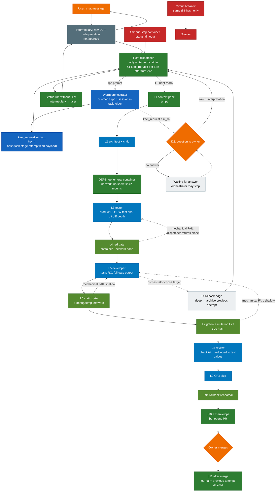

# Orchestrator, dispatcher, and role containers

Design for the Step 7 layer. Numbers not yet measured are marked **starting value, measure**. Among AI runtimes, the pipeline names **Pi** only.

**Status.** Planned. The repository today has role isolation and a host-gate prototype. The dispatcher and the orchestrator container are not built yet. Implementation ships as a process-files pull request.

---

## 1. Two planes in plain words

| Plane | Who | Does | Does not |
|---|---|---|---|
| **Reasoning** | Orchestrator (Pi in its own container) and roles (architect, tester, developer, …) | Understand the task, write the brief, choose *where* to request a transition, ask D2, read what is allowed | Launch containers, write product code, bypass gates, message peer agents |
| **Control** | Host dispatcher (a script, not an agent) | Store task state, check transitions, mount, launch roles via `setup/keel.sh role`, run gates, write journals and the status line | “Think” for the model; merge the PR |

Rule: **agents do not talk to each other**. Everything goes through the dispatcher. There is no scribe agent: append-only journals are written only by the dispatcher.

D2 questions go **only** through the chat intermediary (or a direct Pi terminal into the same dispatcher inbox). There is no second “confirm again” layer on top of D2. There is no `/approve` command.

---

## 2. Path of one task: from a chat message to a PR

### Mermaid



### In words, step by step

1. The user writes to the intermediary (typical path) or into a direct Pi session (same inbox).
2. Intermediary: for D2, passes the **raw answer text** and its **interpretation**; if unclear or they diverge, the orchestrator re-asks; raw text in the audit log. Relay checklist: critical content is not lost; end with what the user must do (or “nothing”). No `/approve`.
3. The message lands in the **dispatcher inbox**. Only the dispatcher writes to the warm orchestrator’s stdin (`pi --mode rpc`). The intermediary **never** holds the rpc stdin fd. Mid-turn messages go into a **queue** and are not dropped. Priority interrupt or cancel mid-turn is backlog. Until that exists, messages wait until the turn ends.
4. The orchestrator reads what is allowed (see §4), thinks, and calls **at most one** `keel_request` per turn. The extension computes a deterministic `idempotency_key`. The tool validates fields and atomically writes the request file (`.tmp` → `rename`).
5. The dispatcher processes the request **only after** rpc turn-end; a second request in the same turn → refusal + audit `second_request_same_turn`. It checks the allowlist and the YAML FSM; writes WAL `IN_PROGRESS` before the side effect, then `COMMITTED` after; writes the status line; launches a role/gate when needed; journals and audits.
6. The L0…L11 chain is as in `docs/architecture.md` / `docs/pipeline.md`; routing goes through the dispatcher FSM.
7. At task end (PR created, cancel, fail/dossier) the orchestrator container is **removed**; the previous-attempt folder is **deleted**. While waiting on the user — only **stop**, resume from the session file.
8. Merge and release — owner only. The intermediary does not merge and does not change GitHub rules.

---

## 3. Who decides what

| Decision | Who |
|---|---|
| Task meaning, brief text, D1 (confidence high/medium/low), D2 wording, choice of **target** back edge; on `TEST_CONTRADICTS_BRIEF` — verify claim vs brief, reformulate finding for L3 (never forward developer prose) | Orchestrator (request) |
| Whether to allow a transition / return; whether to execute `keel_request`; launch role/gate; invalidate artifacts; deep archive / shallow keep; status line; journal; circuit breaker (diff-hash); timeout stop; **auto-return on mechanical FAIL**; refuse a second request in the same turn | Dispatcher |
| D2 answers, split yes/no, new dependency, irreversible ack, skill yes/no, merge, release | Owner / user |
| Relay: raw D2 + interpretation; show status line; **not** a second confirmation layer; **not** `/approve` | Intermediary |
| Own work within the role; L5 signals `NEEDS_CONTEXT` / `NEEDS_DEPENDENCY` / `TEST_CONTRADICTS_BRIEF` / … | Role container (developer) |
| Gate pass/fail from evidence | Gate script in a container with `--network none`, no secrets |

The orchestrator does **not** choose “skip the gate”. On mechanical FAIL the dispatcher **itself** takes the YAML edge with `initiator: dispatcher_only` and returns the task — without a model vote.

---

## 4. Visibility: tests visible, read-only for the developer

| Who | Product tests |
|---|---|
| Every role with a work tree | Sees ordinary tests |
| Tester | Product tree **RO** mounts; writes **only** test dirs (FS); host `git diff --name-only` defense in depth (D-T30) |
| Developer | Tests **RO**; full gate output + stacks on FAIL |
| Orchestrator | Reads tests (like everything else except secrets / `deny.local`) |

Honesty substitute: **L7T mutation** + **L8** (English checklist item above; mutation does not catch hardcoding). The L8 item is **not** verified by a line-check of the instruction file — only behaviorally through a backlog known-bad eval set.

### 4.2 Developer result signals (L5)

Alongside `NEEDS_CONTEXT`, `NEEDS_DEPENDENCY`, `SIGNATURE_CHANGE_NEEDED`, `BRIEF_CONFLICT` — signal **`TEST_CONTRADICTS_BRIEF`**.

Developer instruction (sense; English wording in the role skill/instruction file): *if a test contradicts the brief, do not fit the code to it; stop and return `TEST_CONTRADICTS_BRIEF`, naming the test and the brief clause.*

The dispatcher accepts the signal as `result_name`. The orchestrator **checks the claim against the brief itself** and **decides** whether to call `return_to` L3 on YAML edge `L5_test_contradicts_brief_to_L3` (`budget_ref: L5_test_contradict_returns`, starting value, measure; deep_reset). Developer arguments are **never** forwarded to the tester; only the orchestrator’s own reformulated finding (test id + brief clause + verdict) goes to L3. Behavioral stubs: D-T25 (routing/budget), D-T31 (developer text absent from L3 input).

### 4.1 Failure schema for routing (closed enum)

The dispatcher puts a structured object into the orchestrator inbox for **routing/audit**. Fields:

| Field | Type | Rule |
|---|---|---|
| `pass` | bool | required |
| `failure_category` | enum from `failure_categories` in `dispatcher-transitions-v1.yaml` | required on fail; **not** a free string |
| `rule_id` | short brief rule id (if any) | optional |
| `gate` | gate id (`L4` / `L7` / …) | optional |

In parallel, on gate FAIL the developer receives the **full** output and stacks.

The orchestrator reads everything else **except** secrets and paths from `.keel/deny.local`.

Control-plane writes: only through `keel_request` → dispatcher. Orchestrator argv is fail-closed: read/search class + `keel_request`; `bash` / `write` / `edit` / `codemode` off; mounts read-only except dispatcher channels.

---

## 5. FSM: machine table, transitions, invalidation

**Sole source of edges** — the machine file:

| Where now (design) | Where in the repo after Step 7 (process-files PR) |
|---|---|
| `docs/harness/dispatcher-transitions-v1.yaml` | `setup/dispatcher/transitions.v1.yaml` |

The dispatcher and its tests **load the same file**. Prose tables below are a human overview; on conflict the YAML wins. Test D-T20 loads the YAML and checks edges directly (forbidden/allowed, `invalidates`, `initiator`, **every `kind:back` has non-null `budget_ref`** — D-T19).

### 5.1 File schema

```text
schema_version: 1
format: keel_dispatcher_transitions
failure_categories: [enum…]      # closed list, no free text
budget_refs: [names…]            # numbers are starting values, measure; do not duplicate here
stages: [start, L0, …, dossier]
edges:
  - id: string
    from: stage | "*"
    to: stage | "*"
    kind: forward | back | terminal | reject | side_effect
    initiator: dispatcher_only | orchestrator | owner | script
    when: { … }
    invalidates: [stage…]
    budget_ref: name | null      # null is forbidden when kind is back (schema and D-T19)
    spends_submission: bool?
    deep_reset: bool?            # archive the previous attempt and reset work/$T
    shallow_keep_worktree: bool? # gate to L5: code stays
    note: string?
```

Invalidation: dependent stages → `stale`. Role re-entry: **prior work + reason** (or archive previous attempt on deep). Gates **always** re-run fully. A current PASS exists only for non-stale. PR/envelope with a stale `gated_tree_sha` — **refuse**.

**Deep vs shallow:**
- Deep back to L2 or L3 (`deep_reset: true`): archive into RO `previous attempt` in the task service directory (outside work tree and git); `work/$T` → clean stage commit; archive deleted at task end; tests D-T26. The developer **keeps read access** to the previous-attempt folder; gates/review still judge the new result.
- Shallow (gate → L5): code in the work tree stays for further edits. L6 also fails on leftover debug/temp artifacts in the diff (D-T33).

Budgets: named refs; **numbers are starting values — measure**. Exhaustion → `budget_exhausted` → dossier.

Depth `light` / `trivial` — profiles of the same FSM (some nodes skipped), not a separate product.

### 5.2 Forward edges overview (human)

See the YAML. Short: `start→L0→…→L1→L2→L2C→DEPS→L3→L4→L5→L6→L7→L8→L9→L9B→L10→WAITING_MERGE→L11`, plus waits for D2 / brief v2 / split / dep / irreversible. Forward edges: see the YAML.

### 5.3 Back edges and cascade overview

| Edge (id in YAML) | Initiator | Invalidates | Note |
|---|---|---|---|
| `L4_fail_to_L3` | `dispatcher_only` | L4+ | mechanical FAIL; deep |
| `L2C_return_L2` | orchestrator | L2C and after | `L2_critic_returns`; deep |
| `L5_to_L1_context` | orchestrator | L1 pack | `L5_context_returns`; does not spend submission |
| `L5_to_L2_signature` | orchestrator | after L2 | `signature_change_once`; deep |
| `L5_to_DEPS` | orchestrator | — | `L5_deps_returns`; does not spend submission |
| `L5_test_contradicts_brief_to_L3` | orchestrator | L3+ | `L5_test_contradict_returns`; deep |
| `L6_fail_to_L5` / `L7_fail_to_L5` / `L9B_fail_to_L5` | `dispatcher_only` | gates+after; tree stale | mechanical FAIL; **shallow** |
| `L7_to_L7T` | `dispatcher_only` | L7 | `L7_mutation_gap`; mutation ≠ hardcode catch |
| `L8_blocking_to_L5` | orchestrator | L6+ | `L8_review_rounds`; shallow; hardcode checklist |
| `L9_bug_path` | orchestrator | QA-dependent | `L9_qa_bug_returns`; deep |
| `L10_refuse_stale_tree` | `dispatcher_only` | — | reject, do not open PR |
| `*_budget_dossier` / `any_circuit_breaker` | `dispatcher_only` | — | stop; CB diff-hash only |

**Forbidden:** jump over stale; accept an old gate PASS after a back-edge; open a PR with a stale bind; a back edge without `budget_ref`.

---

## 6. Tool `keel_request`: kinds and fields

One custom Pi tool, enum `kind`. Validation in the extension; atomic write (`.tmp` → `rename`). Raw model `write` is not authoritative and is **unavailable** (argv + mounts fail-closed).

Common fields:

| Field | Meaning |
|---|---|
| `schema_version` | Schema version |
| `task_id` | Task id |
| `kind` | Enum below |
| `idempotency_key` | Computed by the **extension** deterministically: `hash(task, stage, attempt, kind, canonical payload)`. WAL: `IN_PROGRESS` before execute, `COMMITTED` after. Replay of `COMMITTED` → no second execution; audit `idempotent_replay`. Restart with `IN_PROGRESS` → reconcile side effect, then complete or safe retry (D-T18 / D-T32) |
| `payload` | Kind fields |
| `created_at` | Timestamp with zone |

### Kinds (v1 allowlist)

| `kind` | Purpose | Key `payload` fields |
|---|---|---|
| `ask_d2` | Question to the owner | `question`, `options[]`, `default`, `trigger_reason` |
| `brief_upsert` | Brief | D0/D1/D2/oos sections; `version` |
| `record_d1` | Confidence notes | `level` (enum high/medium/low), `notes` |
| `propose_split` | Split | `parts[]`, `estimate_ref`, `reason` |
| `advance` | Move forward | `to_stage`, `result_name` |
| `return_to` | Back edge | `to_stage`, `failure_category` (enum) |
| `run_role` | Launch a role | `role`, `stage`, `inputs_ref` |
| `wait_user` | Wait | `reason` enum: `d2` / `brief_v2` / `dep` / `irreversible` / `skill` |
| `dossier` | Stop | `failure_category` enum, `artifact_refs[]` |
| `record_decision` | ADR / decisions / discovery candidate | `target`, `body_ref` |

`inject_summary_ack` is **not** in the v1 enum (backlog). In v1 the dispatcher pushes the summary through rpc `prompt`.

The dispatcher rejects an unknown `kind`, a broken schema, a transition outside the YAML, a budget overrun, a second request in the same turn, and a `COMMITTED`-key replay. Every refusal is an **explicit refusal** + **audit entry**.

**One request per turn:** the dispatcher accepts a request only after the rpc turn-end event; a second → `second_request_same_turn`.

Extension: orchestrator image or harness mount (`-e`); **never** only a project `.pi/` as control-plane IPC. Idempotency WAL on disk: `IN_PROGRESS` before side effects, `COMMITTED` after.

---

## 7. Status line

The dispatcher writes a deterministic line (no LLM) into the intermediary inbox.

Fields: `task_id`, `stage`, `attempt`, `waiting_reason`, `container_alive`, `last_result` (result name or `timeout` / `rejected_request` / `idempotent_replay` / `second_request_same_turn`), `updated_at` (with zone).

Secrets never appear. Not an rpc side-channel into the model and not a second confirmation UX.

---

## 8. Sessions, warm vs cold, parallel tasks

| | Orchestrator | Role |
|---|---|---|
| Lifetime | Warm per task; **rm** on terminal (PR / cancel / fail/dossier) | Ephemeral `--rm` per stage |
| Pi mode | `--mode rpc` + session on disk | One-shot `--mode json` / print (argv — smoke) |
| Pause | stop while waiting on the user; resume from session | New container |
| Rpc stdin | Dispatcher only | — |

Parallelism: already in `setup/keel.sh` — own `TASK`, `work/$T`, `shadow/$T.git`; objects RO alternates; pointer `.git` RO. Not reopened here.

The orchestrator session is **not** mounted into roles (explicit assert in D-T6 / D-T10).

---

## 9. Gates with product code and DEPS

Any product-code run in gates uses a HARDEN container (`--network none`, no secrets, cap-drop, read-only root + tmpfs, limits) as in `setup/keel.sh`. The dispatcher/doctor **refuse** a script that runs pytest/build on the host OS (D-T17). After `GREEN_PASS` — `gated_tree_sha`; stale bind → refuse PR (D-T15).

**DEPS:** install in an **ephemeral** container **with network**, without host secrets and without control-plane mounts; result (cache/vendor) mounts **RO** into later roles. Default `--ignore-scripts`. Test D-T22.

Green gate: new + old tests + mutation (L7T). L6 static gate also checks leftover debug prints/breakpoints and temp/scratch/backup files in the diff (D-T33; patterns configurable, no invented thresholds).

---

## 10. Circuit breaker and hash stability

Inside existing attempt budgets. Two **consecutive** attempts of the same edge:

1. **Diff-hash** — normalized hash of the role patch (stable file order; ignore harness-rewritten fields per a fixed list in the normalizer).
2. Gate-output hash is **not** a circuit-breaker trigger. The same gate fail with a **different** diff spends the ordinary edge budget, not CB.

Match of the **same** consecutive diff-hash only → `failure_category: circuit_breaker` → dossier.

**Done-when for §10:** CI has a **hash-stability fixture** (D-T21): the same normalized input → the same diff-hash across repeats; a mutant that breaks normalization goes red. D-T12: CB only on diff-hash; different diff with the same gate fail → **not** CB. **Backlog:** normalize comments and formatting before the circuit-breaker hash only after measurements on real tasks. Do not invent how aggressive that normalization is.

---

## 11. Timeouts

Each stage: DEFAULT wall timeout + short container-start timeout. Seconds in config: **starting value, measure**. On fire: stop the container, `status=timeout`, `failure_category: timeout`. Then follow YAML and budgets. Owner D2 wait is not killed by these timeouts.

---

## 12. Crashes and recovery

Truth is on disk. On start: rehydrate store → last clean SHA → orphan cleanup by name/label `task_id` → orchestrator resume from session if needed; do not resurrect mid-flight roles. The Docker-label graph is not the source of truth (v1). Idempotency WAL survives crash: `COMMITTED` keys → idempotent replay; `IN_PROGRESS` → reconcile side effect then complete or safe retry — never silent skip, never blind re-run (D-T18 / D-T32).

---

## 13. Context rot and monitoring

Stage summaries to the orchestrator (structured), not full logs. Pi compaction is not the only defense. The session path is absent from role mounts.

Monitoring: transition/reject/timeout/circuit-breaker journal; status line; attempt/stale; alert on circuit breaker and `second_request_same_turn`; mid-turn message queue must not be lost (manual check on first tasks + D-T23). Priority interrupt or cancel mid-turn is backlog.

Journals are written by the host/dispatcher. Raw D2 text is in the audit log.

---

## 14. L8 checklist and mutation

In the L8 reviewer checklist (English, in the instruction file) an explicit item:

`Code hardcoded to specific test values instead of implementing the behavior`

Mutation (L7T) does **not** replace this item: mutation does not catch hardcoding. The item is **not** in the automated suite as an instruction-file text check. The suite holds **only behavioral** tests (stub model + host fixtures); there are no line/verbatim checks of instruction files. L8 hardcode quality is checked **only** through a backlog known-bad example in a future reviewer eval set.

---

## 15. Risks (open)

- Hardcoding to visible tests — mitigation: L8 English checklist item + known-bad eval backlog (behavioral); not mutation; not instruction-file line-checks.
- Paraphrase / divergence of raw D2 and interpretation — orchestrator re-asks.
- Deep archive leak into git/PR — D-T26; path outside the work tree.
- Budget numbers — starting values, measure. The per-task total budget stays warn-only until it is measured.
- Mid-turn cancel waits until the turn ends.
- Stripping comments before the circuit-breaker hash waits until false positives and false negatives are measured.
- The developer may read the previous-attempt archive. Gates and review still check the new result.

---

## 16. Dispatcher tests (stub-model), wiring into `run-tests.sh` / keel-gate

Style: stub model + host fixtures; mutants like `mutate.py` (remove a protection → expected D-T* go red). Step 7 process-files PR: add calls in `run-tests.sh` / keel-gate (mutate wiring is part of Step 7 done-when).

| Id | Checks |
|---|---|
| D-T1 | Forbidden transition → **explicit refusal** + audit; stage unchanged |
| D-T2 | Allowed YAML transition executes; journal append |
| D-T3 | Invalidation: stale; old PASS not accepted; gate re-run |
| D-T4 | Broken request → refusal + audit; not executed |
| D-T5 | No write/bash on orchestrator → explicit refuse + audit; mutant “restore write” goes red |
| D-T6 | Session isolation: orchestrator session path **absent** from role mounts; secrets/`deny.local` not visible to orchestrator |
| D-T7 | Tester write-scope (host): path outside test dirs → refuse + `test_write_scope_violate`; tests RO for developer (write → EROFS). Mount-level product read-only for L3: see D-T30 |
| D-T8 | Timeout: DEFAULT fixture (**starting value, measure**) → stop, `status=timeout` |
| D-T9 | Crash recovery: rehydrate + last clean SHA; orphan removed |
| D-T10 | Parallel tasks: two TASKs isolated; session A not in mount B |
| D-T11 | Status-line: required fields; no secrets |
| D-T12 | Circuit breaker: two identical **diff-hash** in a row → dossier; same gate fail with **different** diff → **not** CB, spends budget |
| D-T13 | Stdin ownership: second writer to rpc stdin → refuse + audit |
| D-T14 | Mechanical FAIL auto-return without orchestrator `keel_request` |
| D-T15 | Stale `gated_tree_sha` → refuse PR; audit |
| D-T16 | Orchestrator rm at end; after D2-wait — stop, not rm |
| D-T17 | Host product-code gate refuse |
| D-T18 | Idempotency: replay of `COMMITTED` key → no second execution; audit `idempotent_replay`; crash after commit before session flush still safe. Mid-effect crash / `IN_PROGRESS` reconcile: D-T32 |
| D-T19 | Budget: every `kind:back` has non-null `budget_ref` (schema + loader); exhaustion → dossier; mutant “null budget on back” goes red |
| D-T20 | YAML FSM directly: forbidden/allowed edges; `invalidates`; `initiator`; every `kind:back` has non-null `budget_ref` |
| D-T21 | Hash-stability: fixed input → stable **diff-hash**; normalizer mutant goes red |
| D-T22 | DEPS ephemeral: network present; no host secrets / control-plane mounts; cache/vendor RO afterward; `--ignore-scripts` by default |
| D-T23 | One `keel_request` per turn: second before turn-end → `second_request_same_turn`; mid-turn user message stays queued |
| D-T24 | Deterministic idempotency key: same `(task, stage, attempt, kind, canonical payload)` → one key; different payload → different |
| D-T25 | Behavioral stub: stub-developer returns `TEST_CONTRADICTS_BRIEF` (test name + brief clause); orchestrator chooses `return_to` L3 → dispatcher takes `L5_test_contradicts_brief_to_L3`, spends `L5_test_contradict_returns`, deep archive; repeat to exhaustion → dossier |
| D-T26 | Deep archive previous-attempt: outside work tree/git; not in commit/PR; deleted after task end; shallow L5 keep worktree |
| D-T27 | Intermediary D2: raw text + interpretation arrive; on divergence — re-ask; raw in audit; no `/approve` path |
| D-T28 | Developer on FAIL receives full gate output / stacks (not sanitized “rule text only”) |

**No D-T29.** The L8 hardcode item lives in the English checklist instruction; its presence is **not** tested by a line-check of the instruction file. Suite = behavioral stubs only. Item quality — backlog known-bad eval set.

| D-T30 | L3 mounts: product tree read-only; writes only in test dirs. Stub: tester tries to write a product file → write fails (EROFS / equivalent). Host `git diff --name-only` still refuses out-of-scope paths (defense in depth with D-T7). Mutant: RW product mount → D-T30 red |
| D-T31 | `TEST_CONTRADICTS_BRIEF`: stub-developer returns signal with distinctive developer prose; orchestrator reformulates; L3 input must **not** contain the developer text (only orchestrator finding). Mutant: forward raw developer args → D-T31 red |
| D-T32 | Two-phase WAL: write `IN_PROGRESS`, kill dispatcher before `COMMITTED`, restart; side effect happens **exactly once** (reconcile then complete or safe retry — never silent skip, never blind double-run). Mutant: skip reconcile / blind re-run → D-T32 red |
| D-T33 | L6 leftover debug/temp: diff with a leftover breakpoint or temp/scratch/backup file → L6 FAIL (`static_debug_leftover` or configurable pattern hit). Patterns configurable; no invented thresholds. Mutant: disable leftover check → D-T33 red |

**Mutants (examples):** drop YAML check; drop stale; accept any JSON; restore write/bash; let tester write outside test dirs; RW product mount for L3; RW tests for developer; no stop on timeout; no orphan cleanup; shared shadow; no status write; CB on gate-hash (must go red on D-T12); second stdin fd; skip auto-return; PR on stale tree; no orchestrator rm; host gate; ignore idempotency / skip WAL reconcile; null `budget_ref` on back; break normalizer; skip turn-end gate; mount secrets into DEPS; leave previous-attempt in work tree; accept second request same turn; forward developer prose to L3; disable L6 leftover patterns.

Hash-stability (D-T21) and mutants belong in dispatcher attacks / the same `run-tests.sh`.

---

## 17. Non-negotiable rules for this layer

1. Agents do not peer-message; only through the dispatcher.
2. Mechanical FAIL → only `dispatcher_only` YAML edges (D-T14).
3. Sole FSM source = YAML; prose is not a second truth.
4. Circuit breaker = same consecutive **diff-hash**; hash-stability fixture in CI is done-when.
5. Tests visible; tester write-scope; developer RO tests + full stacks; L7T+L8 as honesty substitute.
6. Every `kind:back` — non-null `budget_ref`.
7. ≤1 `keel_request` per turn after turn-end.
8. Idempotency key deterministic from the extension; two-phase WAL `IN_PROGRESS`/`COMMITTED` with reconcile on restart.
9. Deep → previous-attempt archive outside git; developer keeps RO read of archive; shallow L5 keeps code.
10. D2: raw + interpretation; no `/approve`.
11. L3: product RO + RW test dirs at mounts; `git diff` defense in depth.
12. `TEST_CONTRADICTS_BRIEF`: orchestrator verifies vs brief; never forward developer prose to L3.
13. L6 fails leftover debug/temp artifacts in the diff; patterns configurable.

---

## 18. Link to the plan and the repo

Main implementation is **Step 7**. Step 7 (dispatcher, extension, FSM YAML, tests, `run-tests.sh` edits, visibility mounts, DEPS ephemeral, archive previous-attempt) is a **process-files PR** (touches `setup/`, and if needed wiring under `.github/`); **do not** mix with product code.

Design docs for this layer live under `docs/harness/` in this repository. The machine YAML in this directory is the design source. The process-files pull request will place the runtime copy under `setup/dispatcher/`.

## Known residual risk: fitting code to tests

Protection against fitting code to visible tests is incomplete in v1:
- mutation tests (L7T) do not catch fitting;
- L8 item `Code hardcoded to specific test values instead of implementing the behavior` is an English instruction; the suite **intentionally** does not line-check instruction files; item quality is checked only via a known-bad eval set (backlog);
- `TEST_CONTRADICTS_BRIEF` fires on the developer signal; the orchestrator verifies vs brief and reformulates for L3 (D-T25 and D-T31).

Helps: tests RO for the developer; L3 product RO + write-scope (D-T7 and D-T30). Further risk reduction — known-bad hardcode in the reviewer eval set (backlog).

## Test status

Tests D-T1…D-T28 plus D-T30…D-T33 are planned (behavioral only; no instruction-file line-checks; D-T29 reserved unused). Today `run-tests.sh` runs only happy, attacks, and doctor; `mutate.py` runs only offline; `setup/dispatcher` does not exist yet. Wiring those tests into `run-tests.sh` / keel-gate is part of the Step 7 process-files PR. Until then, claiming they are a mandatory CI check would be wrong.
